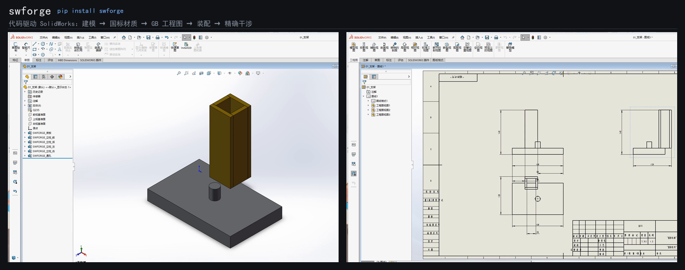

**中文** | [English](README.en.md)

# swforge

**让 SolidWorks 少一点重复操作，多一点可复用成果。**

从参数化零件、材料配色，到装配、工程图、BOM 和 PDF，swforge 把常用机械设计步骤串起来，方便重复执行，也方便核对结果。

[](https://pypi.org/project/swforge/) [](LICENSE) [](docs/validation-community.md)

[](https://github.com/mwdandoms/swforge/releases/download/v1.4.1/swforge-demo-2m21s-1080p60.mp4)

点击查看历史版本演示：建模、材料、工程图、标注与装配。演示录制于1.4.1，并非本次社区版的全部功能验收。

## 能帮你做什么

| 你的工作 | swforge 可以提供 |
|---|---|
| 同类零件反复画 | 参数化板件、方管、圆柱、旋转体、切除、孔、倒角和圆角；另存变型 |
| 材料、颜色反复设置 | GB牌号材料库、规则配色，以及材料和颜色回读 |
| 装配整理与检查 | 组件、配合、干涉检查、装配变型和原生BOM |
| 工程图反复整理 | 三视图、剖视、局部放大、尺寸、公差和粗糙度 |
| 按统一风格出图 | A0–A4基础GB导向模板、第一角投影、标题栏、字体与线宽检查 |
| 多份文件一起交付 | 批量出图、多页图册、PDF/DWG/DXF导出及交付记录 |
| 用AI助手协助设计 | 接入支持MCP的助手，也可以直接使用Python或命令行 |

**结果可以回读核对。** 材料是否写入、颜色是否生效、尺寸是否附着、导出文件是否为本轮生成，都有相应检查入口。检查覆盖范围会明确说明，工程师仍需审核最终图纸。

## 与同类工具相比，侧重点在哪里

| 工具或方式 | 官方介绍或常见使用重点 | swforge的适用侧重 |
|---|---|---|
| 项目专用宏 | 固定步骤的重复执行；具体能力取决于宏实现 | 把建模、改型、出图、交付连接成可重复使用的流程 |
| [CAD+ Toolset](https://cadplus.xarial.com/) | 属性、批处理、导出、BOM及桌面/PDM工具 | 适合希望同时通过脚本、命令行和AI助手完成参数化工程任务的用户 |
| [AssetMate MechDog](https://github.com/wudahua/Solidworks_AssetMate_MechDog) | SolidWorks MCP、工程图标注、特征台账和交付检查 | swforge提供参数化实体/机械家族、变型、GB基础出图与多页交付流程；部分工程图增强可与MechDog配合 |

对比依据为上述项目官方介绍及swforge当前功能范围，不是同任务性能测试，也不代表其他产品缺少某项能力。swforge目前只实测SW2025 SP5，不以兼容版本数量或速度倍数作为宣传卖点。

## 安装与开始

需要Windows、Python 3.10+，以及你已有的SolidWorks安装和使用授权。当前实机环境为SolidWorks 2025 SP5。

```bash
pip install swforge
pip install "swforge[mcp,pdf]"  # AI助手接入与PDF校验
swforge --help
```

```python
from swforge import PartBuilder

result = (PartBuilder(r"F:\out\plate.SLDPRT", material="Q235")
          .box("plate", 0, 120, 0, 80, 0, 20)
          .build(keep_open=False))
print(result.ok)
```

使用新输出路径并保留原模型。批处理时注意打开的SW文档数量，默认上限8份。

## 社区版与后续高级模块

**本仓库及PyPI的Community版为MIT开源，允许商业使用。** 包含建模、材料配色、装配、标注、BOM、图册、批处理、基础GB模板与校验、结果回读和文档保护。

高级GB条文审查、栅格/整套一致性审图及工艺规则编排实现，本次不包含在GitHub、源码包或wheel中，保留本地待拆分。未来高级模块是否发布及其许可将单独说明；当前没有把它们作为已上线商业功能出售。此前已MIT公开的版本继续遵循原许可。

基础GB功能也有覆盖范围：配合表为有限代号和尺寸段；字体尚未认证精确长仿宋；图纸检查不是完整GB认证、制造批准或强度认证。几何公差现有五类接口，本轮保存重开实测为平面度。详见[社区版范围](COMMUNITY_SCOPE.json)和[验证说明](docs/validation-community.md)。

MCP用户升级注意：1.7使用`sw_discover`、`sw_describe`、`sw_invoke`、`sw_status`四个入口。先发现操作，再按需查看和调用；Python和CLI继续保留社区版操作。见[迁移说明](docs/community-migration.md)。

## 致谢与反馈

保留原项目及依赖许可。感谢[AssetMate MechDog](https://github.com/wudahua/Solidworks_AssetMate_MechDog)等开源项目提供的工程图能力与经验。问题反馈请附SW版本、最小示例和回读结果，避免附带企业敏感模型。

---

[中文](README.md) | **English**

# swforge

**Less repetitive work in SolidWorks. More reusable engineering results.**

Build parameterized parts, apply materials and colors, prepare assemblies and drawings, and deliver BOMs and PDFs through repeatable workflows—with readback checks where supported.

[](https://pypi.org/project/swforge/) [](LICENSE)

## What you can do

| Work | Community features |
|---|---|
| Repeated part designs | Plates, tubes, cylinders, revolved bodies, cuts, holes, fillets, chamfers and copy-only variants |
| Materials and appearance | GB-designated materials, rule-based colors and readback |
| Assemblies | Components, mates, interference checks, variants and native BOM tables |
| Drawings | Standard views, sections, details, explicit dimensions, tolerances and surface-finish symbols |
| Consistent presentation | A0–A4 GB-oriented templates, first-angle projection, title fields and basic font/line-weight checks |
| Deliverables | Batch drawings, multi-sheet books, PDF/DWG/DXF export and artifact freshness records |
| AI-assisted work | MCP access, alongside Python and command-line interfaces |

Checks expose their coverage and limitations. Generated drawings still require engineering review.

## How it compares

| Approach | Published focus | Where swforge fits |
|---|---|---|
| Project-specific macros | Replaying a particular sequence; capabilities depend on implementation | Reusable workflows spanning modeling, variants, drawings and delivery |
| [CAD+ Toolset](https://cadplus.xarial.com/) | Properties, batch processing, export, BOM and desktop/PDM utilities | Parameterized engineering tasks accessible through scripts, CLI and AI assistants |
| [AssetMate MechDog](https://github.com/wudahua/Solidworks_AssetMate_MechDog) | SolidWorks MCP, drawing annotations, feature ledgers and delivery checks | Parameterized geometry/mechanical families, variants, basic GB-oriented drawings and multi-sheet delivery; optional drawing enhancements can work with MechDog |

This is a positioning comparison based on official descriptions, not a shared-task benchmark or a claim that competing products lack particular features. Only SW2025 SP5 has been tested locally; no speed multiplier or cross-version guarantee is claimed.

## Install

Windows, Python 3.10+ and your own licensed SolidWorks installation are required.

```bash
pip install swforge
pip install "swforge[mcp,pdf]"
swforge --help
```

Keep source models and use new output paths. The default open-document limit is eight.

## Open-source boundary

The GitHub repository and PyPI Community distributions are MIT-licensed, including commercial use. They include modeling, materials/colors, assemblies, annotations, BOMs, drawing books, batch APIs, basic GB templates/checks, readback and document protection.

Advanced GB clause review, raster/drawing-set review and process-rule orchestration implementations are withheld from this release, including the sdist and wheel. They remain local pending a separate module and licensing decision. They are not advertised as an available paid product. Earlier MIT releases retain their original license.

Basic GB coverage is finite: limited fit codes/size ranges, no certified exact long-FangSong font coverage, and no complete GB/manufacturing/strength certification. Five GD&T characteristics have interfaces; saved-and-reopened flatness was the native fixture tested this round. See [scope](COMMUNITY_SCOPE.json) and [validation](docs/validation-community.md).

MCP migration: use `sw_discover`, `sw_describe`, `sw_invoke` and `sw_status`; original operation names are invoked through the gateway. Community Python and CLI operations remain available. See [migration](docs/community-migration.md).

## Acknowledgements

Original and dependency license notices are preserved. Thanks to [AssetMate MechDog](https://github.com/wudahua/Solidworks_AssetMate_MechDog) and other open-source projects. Report issues with your SW version and a minimal example; omit confidential models.
