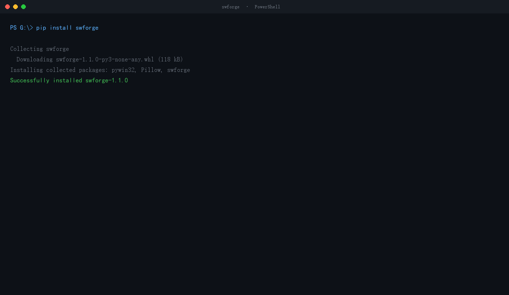

[中文](README.md) | **English**

# swforge

**Drive your local SolidWorks from Python, CLI, or MCP — modeling, GB material assignment, assembly mates, interference checks, and GB-standard drawings, with readback verification at every step.**

[](https://www.python.org/)
[]()
[](https://mwdandoms.github.io/swforge/)
[](https://pypi.org/project/swforge/)
[](https://pypi.org/project/swforge/)
[](LICENSE)
[](https://github.com/mwdandoms/swforge/actions/workflows/tests.yml)

> Tested end-to-end only on **SolidWorks 2025 SP5.0 + Windows + Python 3.14**.
> Version compatibility (targeting 2019+) is the main goal of the next release.

---

---

## Understand it in 30 seconds



> This animation is **rendered from real output, not a screen recording**.
> It shows `swforge selftest` on SolidWorks 2025 SP5.0; `demo/make_gif.py`
> reproduces it.
>
> Each of the ten checks runs against the real SolidWorks and reads the result
> back before judging. Note the four indented lines: volume off by **0.000%**,
> density **7850 kg/m3**, interference **4000.0 mm3**, mate moving the parts
> from **X=[60.0, 0.0] to [0.0, 0.0]**.
> Those numbers were read back, not inferred from a call not raising.

## What problem does it solve

SolidWorks automation falls into three camps, each with its own traps:

| Approach | Batch modeling | Drawings | Coloring | Assembly mates |
|---|---|---|---|---|
| VBA / raw COM | Slow (IDispatch round-trips) | Everyone rolls their own | Body-level assignment silently fails | Possible, very verbose |
| Commercial add-ins | Fast | Strong | Strong | Strong |
| **This project** | Generates C# early-binding code — fast | **GB frame + auto dimensions + overall dimensions** | **Face-level write + readback, 100%** | **Concentric / coincident with auto face selection** |

Concrete problems it addresses:

1. **LLMs produce invalid parameters** → `spec.py` validates before execution and reports `cylinders[0]: cylinder.axis must be x/y/z` instead of crashing inside COM.
2. **You cannot tell whether a build succeeded** → body count, envelope, per-face colors, material, mass, and volume are all read back.
3. **Coloring appears to be set but is not applied** → face-level write plus readback comparison, verified 126/126 faces.
4. **GB material assignment fails silently** → the default density falls back to **1000 kg/m³ (water)**, making mass wrong by 7.85×. The project ships a 20-grade GB material library and deploys it automatically.
5. **Drawings come out in inches with no frame** → automatically picks the Chinese `gb_<paper>.drwdot` template, which carries the frame, title block, material, weight, and scale.
6. **No overall dimensions** → `dims.py` adds overall length/height explicitly from the view's extreme visible vertices.
7. **Interference checks return nothing** → the assembly-level API returns 0 for a known 500 mm³ overlap on this machine, so the project uses **part-level boolean intersection** and reports an exact 500.000 mm³.
8. **Documents pile up and drag SolidWorks down** → a three-tier resource guard plus safe sweeping.

---

## Key numbers

| Item | Value |
|---|---|
| Source | **~4,400 lines** of Python across 14 modules |
| Tests | **124** (95 offline + 29 live) |
| MCP tools | **22** |
| Public exports | **41** |
| GB material grades | **20** (density / elastic modulus / Poisson's ratio / standard reference) |
| Geometry | box / plate / tube(XYZ) / cylinder(XYZ) / revolve(XYZ) / fillet / chamfer |
| Verified environment | SolidWorks 2025 SP5.0 (33.5.0) + Python 3.14.3 |

---


## Not yet (stated up front)

This section exists so you know the boundaries **before** installing, not after.

| Not done | Why |
|---|---|
| **Fully verified only on SolidWorks 2025 SP5.0** | 2019-2024 untested. Run `swforge capabilities --api` to check your own machine |
| **Older file formats** | Files saved by 2025 cannot be opened by 2019; no version-downgrade save |
| **Tolerances / surface finish are not generated** | Deliberate: no invented engineering requirements. Add them by hand for now |
| **Section views / detail views** | Basic three views only |
| **BOM / exploded views** | Not implemented |
| **Gears / sheet metal / weldments** | Boxes, plates, tubes, cylinders, revolves, fillet and chamfer only |
| **Drawing to model (reverse rebuild)** | Not implemented |
| **Assembly-level interference API** | Returns 0 for a known overlap on this machine; part-level boolean intersection is used instead |

---

## Install

```powershell
git clone https://github.com/mwdandoms/swforge.git
cd swforge
pip install "swforge[mcp,pdf]"
```

**Requirements**: Windows + SolidWorks (verified on 2025 SP5.0) + Python 3.10+

Optional extras:

| extras | Provides |
|---|---|
| `[mcp]` | MCP server (22 tools) |
| `[pdf]` | PDFium-based PDF content verification |
| `[mechdog]` | Delegates deep annotation and manufacturing review to MechDog |

---

## Quick start

### One-command self check

```powershell
swforge capabilities
```

Prints the SolidWorks version, connection latency, and whether MechDog is available.

### Modeling with a GB material

```python
from swforge import PartBuilder

b = PartBuilder(r"D:\out\bracket.SLDPRT", material="Q235")
b.box("base plate", 0, 160, 0, 20, 0, 100, "steel")
b.tube_y("column", 20, 140, 60, 0, 40, 40, wall=6, color="yellow")
b.cylinder("hole", axis="y", x=80, y=20, z=50, r=8, h=20, color="gray")

r = b.build()
print(r.ok, r.bodies, r.mass_kg, r.volume_mm3)
# True 10 3.281 417920.0
```

### Drawings (GB frame + auto dimensions + overall dimensions)

```python
from swforge import produce, add_dimensions, normalize_layout, export_pdf

produce(model, drawing, paper="A3")          # picks gb_a3.drwdot automatically
add_dimensions(drawing, overall=True)        # model dimensions + overall length/height
normalize_layout(drawing)                    # long-align / height-align / 35 mm+ spacing
export_pdf(drawing, r"D:\out\drawing.pdf")
```

The result contains a GB frame (zones A–F / 1–8), a title block (material / weight / scale),
millimetre dimensions, overall dimensions, and three views aligned per drafting convention.

### Assembly, mates, interference

```python
from swforge import AssemblyBuilder, MateBuilder, body_interference

a = AssemblyBuilder(r"D:\out\assembly.SLDASM")
a.add(r"D:\out\base.SLDPRT", 0, 0, 0, fixed=True)   # coordinates are in mm
a.add(r"D:\out\pin.SLDPRT",  60, 0, 0)
a.build()

m = MateBuilder(r"D:\out\assembly.SLDASM")
m.concentric(0, 1)        # finds equal-radius cylindrical faces automatically
res = m.apply()
# the pin moves from 60 mm to 0 mm and becomes coaxial

body_interference(part, "A", "B")
# {'interfere': True, 'interference_volume_mm3': 500.0}
```

### MCP — works with any MCP-capable agent

Standard MCP over stdio. Verified with the official MCP client: protocol `2025-11-25`,
22 tools with valid schemas, and `serverInfo.version` reporting 0.9.0.

**Claude Desktop** (`%APPDATA%\Claude\claude_desktop_config.json`)

```json
{
  "mcpServers": {
    "swforge": {
      "command": "C:\\Python313\\Scripts\\solidworks-swforge.exe",
      "args": []
    }
  }
}
```

**Cursor / Cline / Codex / Windsurf / DSH** (`mcp.json`, or the client's settings UI)

```json
{
  "mcpServers": {
    "swforge": {
      "command": "python",
      "args": ["-m", "swforge.server"]
    }
  }
}
```

> `python -m swforge.server` is the most robust form: it does not depend on the script
> being on PATH. Install with `pip install "swforge[mcp]"` first.

**The server tells the agent how to use it.** The handshake returns 17 lines of
`instructions`: SolidWorks must already be running, lengths are millimetres, the
8-document cap, and the recommended flow
(validate -> build -> color -> read_colors -> drawing -> layout -> pdf).
`tests/test_mcp.py` keeps this honest.

22 tools: `sw_validate_part`, `sw_build_part`, `sw_apply_colors`, `sw_read_colors`,
`sw_survey`, `sw_produce_drawing`, `sw_layout_views`, `sw_export_pdf`,
`sw_list_materials`, `sw_ensure_material_library`, `sw_resource_status`, and more.

---

### Batch drawings (one folder to a stack of sheets)

```powershell
swforge batch D:\parts --pdf --report report.json
```

* One bad part does not sink the batch; the reason is recorded per item
* Existing drawings are skipped by default, so an interrupted run can resume
* Documents are released after each part (SolidWorks caps at 8; without this the batch fails silently)

### Version capability probe (first thing to run on a new machine)

```powershell
swforge capabilities --api
```

Reflects over the locally installed Interop library and reports, for every risky API,
whether it exists and its highest overload. If the declared type is wrong it scans
globally and reports the real location — `InsertModelAnnotations4` turned out to live on
`IDrawingDoc`, not `IModelDocExtension`.

---

## Demo

You can see it work without installing — the demo runner executes step by step and
stops to tell you what should be on screen:

```powershell
python demo/demo.py            # interactive, pauses after each step
python demo/demo.py --auto     # run straight through
python demo/demo.py --step 4   # only step 4 (drawings)
```

Six steps: environment check → modeling + coloring → GB materials → drawings →
assembly + mates → interference. Output lands in `demo/out/`.

---

---

## Verification boundary (three layers, results do not carry across)

| Layer | Where it runs | Covers | **Does not cover** |
|---|---|---|---|
| **L1 offline** | Any machine | `pytest -m "not sw"`, **106 tests**: geometry math, spec validation, file collection, CLI, result shapes | Anything needing a SolidWorks process |
| **L2 hosted CI** | GitHub `windows-latest` x Python 3.10-3.13 | All of L1 + package build + sdist content check + `sw` marker guard | Real CAD execution |
| **L3 live acceptance** | **Maintainer's machine only** (Win11 + SolidWorks 2025 SP5.0) | All 124 tests, real modeling / drawings / assembly / mates / interference | Other machines, other SolidWorks versions |

Three things that must be said:

1. **There is no SolidWorks on CI and no remote CAD evidence.** Any claim that "remote CAD CI passed" is false.
2. **Passing on my machine does not mean passing on yours.** Run `swforge capabilities --api` first.
3. **`--api` probes whether an API exists, not whether its behaviour is correct.** A method present in 2019 does not guarantee identical behaviour to 2025.

---

## Design principles

1. **Never fake success** — `ready_for_manufacture` is always `False`, `review_required` is always `True`, and tests enforce it.
2. **Destructive operations default to dry-run** — `purge_*` and `sweep_documents` list before acting.
3. **Never touch the user's documents** — only documents this run created are closed; anything with unsaved changes is skipped.
4. **Never invent engineering data** — drawings do not get automatic tolerances; materials use a GB table with cited standards.
5. **Judgments must rest on independent readback** — `errStatus` and `ok` can both be false signals (see pitfalls).

---

## Pitfalls we hit (the most valuable asset here)

| Symptom | Truth |
|---|---|
| `AddMate5` returns `errStatus=1` | That is not a failure — `swAddMateError_NoError = 1` |
| `Operations2` returns `(None, 1)` | Document bodies are not API temporary bodies; call `Copy2()` first |
| `FixComponent()` returns None | It actually succeeded; check `IsFixed` instead |
| `material="Q235"` is accepted | It was never applied — mass was computed at water density (1000 kg/m³) |
| `IFace2.GetSurface()` reports "member not found" | Unavailable via pywin32 late binding; must go through C# early binding |
| Cannot connect when SolidWorks was started via COM | It is not in the ROT; fall back from `GetActiveObject` to `CreateInstance` |
| Assembly parts land 60 metres away | `AddComponent5` expects **metres** while the project convention is **millimetres** |

See [`docs/pitfalls.en.md`](docs/pitfalls.en.md) for the full list.

Deep dive: [**Why SolidWorks GetActiveObject fails**](docs/why-getactiveobject-fails.md) (Chinese)

---

## Known limitations

* Verified only on SolidWorks 2025 SP5.0 — **2019–2024 untested**
* Generated `.SLDPRT` files use the current format; older SolidWorks cannot open them (no version-downgrade save yet)
* Automatic annotation inserts model driving dimensions, deduplicated across views, capped around 18; overall dimensions are added separately by `dims.py`
* Overall dimensions on the right/top views may snap to inner contours (to be fixed)
* Tolerances and surface finish are **not generated** (deliberate: no invented engineering requirements)
* The assembly-level interference API is unusable on this machine; interference goes through part-level booleans
* Modeling costs about **2.65 s per shape**; 100 shapes take roughly 4.5 minutes

See `docs/limitations.en.md` for details.

---

## Repository layout

```
src/swforge/
├── session.py       unified session: liveness probe, classified retry, single-STA serialization
├── modeling.py      DSL → C# early-binding modeling + face-level coloring
├── colors.py        rule-based face coloring + readback
├── cleanup.py       STEP import survey and junk-body purge
├── gb_materials.py  20 GB grades + material library generation
├── assembly.py      component insertion + fixing
├── mates.py         concentric / coincident mates (auto face selection)
├── interference.py  exact interference volume
├── dims.py          explicit overall length / height dimensions
├── drawing.py       drawing production, template selection, annotation, layout, PDF
├── resources.py     three-tier resource guard
├── spec.py          JSON specification validation
├── server.py        MCP server (22 tools)
└── cli.py           command line
```

---

## Development

```powershell
# offline tests only (no SolidWorks required; use this in CI)
python -m pytest tests -q -m "not sw"

# full suite (SolidWorks must be running)
$env:SWFORGE_LIVE = "1"
python -m pytest tests -q
```

**SolidWorks must be started manually and its main window fully visible**, otherwise the live tests fail.

---

## Roadmap

| Version | Theme | Status |
|---|---|---|
| v0.5 | Connection fallback, GB materials, honesty tests | ✅ |
| v0.6 | Three-axis revolve, auto dimensions, assembly | ✅ |
| v0.7 | GB frame, millimetre units | ✅ |
| v0.8 | Overall dimensions, mates, exact interference | ✅ |
| **v0.9** | **SolidWorks version compatibility (2019+)** | planned |
| v1.0 | Tolerances/finish, BOM, exploded views | planned |

---

## License

MIT. See [LICENSE](LICENSE).

The optional [MechDog](https://github.com/wudahua/Solidworks_AssetMate_MechDog) dependency
(also MIT) is called only through its Python API; no code is copied.
