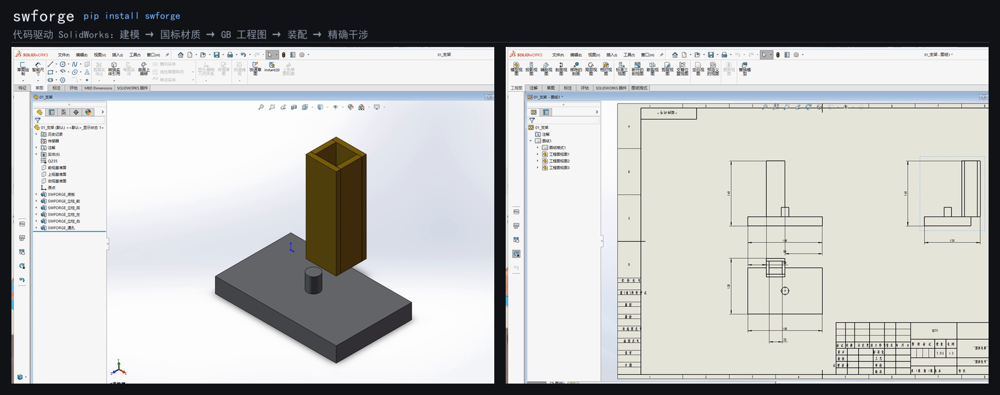
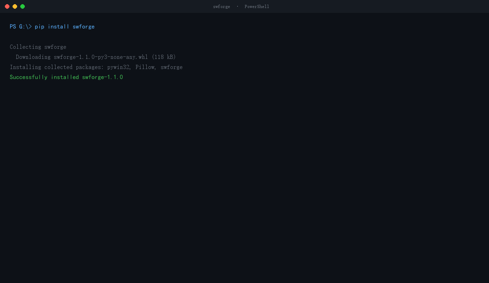

**中文** | [English](https://github.com/mwdandoms/swforge/blob/main/README.en.md)
# swforge

**用 Python / 命令行 / MCP 驱动本机 SolidWorks —— 建模、配 GB 材质、装配配合、查干涉、出 GB 标准工程图，每一步都有回读验证。**

[](https://www.python.org/)
[]()
[](https://mwdandoms.github.io/swforge/)
[](https://pypi.org/project/swforge/)
[](https://pypi.org/project/swforge/)
[](https://github.com/mwdandoms/swforge/blob/main/LICENSE)
[](https://github.com/mwdandoms/swforge/actions/workflows/tests.yml)

[](https://github.com/mwdandoms/swforge/releases/download/v1.2.1/swforge-demo-100s-1080p.mp4)

> ▶ **点击上图播放 100 秒完整演示**（7.6 MB）——从 SolidWorks **关闭状态**开始，
> 建模 → 配国标材质 → 出 GB 工程图 → 装配配合 → 干涉检查，全程无人操作。
> 左边是建出来的零件，右边是同一套代码出的 GB 图。

> 本项目只在 **SolidWorks 2025 SP5.0 + Windows + Python 3.14** 上做过完整实测。
> 版本兼容（目标下探到 2019）是下一版的主要目标，见路线图。

---

---

## 30 秒看懂它是什么



> 这是**真实输出渲染成的动图**，不是录屏。内容是 `swforge selftest` 在
> SolidWorks 2025 SP5.0 上的实测结果，`demo/make_gif.py` 可复现。
>
> 十三项检查每一项都在真机上跑，读回结果再判定。注意那四行小字——
> 体积偏差 **0.000%**、密度 **7850 kg/m³**、干涉 **4000.0 mm³**、
> 配合前后位置 **X=[60.0, 0.0] → [0.0, 0.0]**。
> 这些数字是读回来的，不是「调用没报错」。

## 它解决什么问题

v1.4.1 新增[显式配合选面](https://github.com/mwdandoms/swforge/blob/main/docs/face-mates.md)：通过持久面引用指定孔轴或平面，核对原生配合实体与装配几何，支持失败批次回退。

v1.4 新增按明确要求设置尺寸公差和粗糙度符号，支持 Python、CLI、MCP，含回读验证。
公差偏差用毫米，符号位置用米；用法与实机验收入口见 [标注文档](https://github.com/mwdandoms/swforge/blob/main/docs/annotations.md)。

SolidWorks 自动化有三类工具，各有各的坑：

| 做法 | 批量建模 | 出工程图 | 分色 | 装配配合 |
|---|---|---|---|---|
| VBA / COM 脚本 | 慢（IDispatch 每次往返） | 各写各的 | 体级赋值经常静默失效 | 能写，很啰嗦 |
| 商业插件 | 快 | 强 | 强 | 强 |
| **本项目** | 生成 C# 早期绑定，快 | **GB 图框 + 自动标注 + 总尺寸** | **面级写入 + 回读，100%** | **同心/重合，自动选面** |

具体解决这些真问题：

1. **AI 会产出非法参数** → `spec.py` 在执行前校验，报 `cylinders[0]: cylinder.axis 必须为 x/y/z`，而不是崩在 COM 里
2. **建完不知道对不对** → 实体数、包络、逐面颜色、材质、质量、体积全部回读
3. **配色设了不生效** → 面级写入 + 回读比对，实测 126/126 面
4. **GB 牌号赋值静默失败** → 实测默认密度退回 **1000 kg/m³（水）**，质量错 7.85 倍；本项目自带 20 个 GB 牌号的材质库并自动部署
5. **工程图是英寸、没图框** → 自动选中文 `gb_<纸张>.drwdot`，带图框、标题栏、材料、重量、比例
6. **没有总尺寸** → `dims.py` 按视图可见顶点极值显式补总长/总高
7. **干涉查不出来** → 装配级 API 在本机对 500 mm³ 重叠返回 0，改用**零件级布尔求交**，精确到 500.000 mm³
8. **文档越开越多把 SW 拖垮** → 三档资源守卫 + 安全清扫

---

## 核心数字

| 项目 | 数值 |
|---|---|
| 源码 | **7 887 行** Python，25 个模块 |
| 测试 | **238 项离线 + 13 项实机自检；历史双进程并发实测** |
| MCP 工具 | **30 个** |
| CLI 子命令 / Python 导出 | **24 个** / **64 项** |
| GB 牌号 | **20 个**（密度 / 弹性模量 / 泊松比 / 国标出处） |
| 几何能力 | box / plate / tube(XYZ) / cylinder(XYZ) / revolve(XYZ) / fillet / chamfer |
| 实测环境 | SolidWorks 2025 SP5.0 (33.5.0) + Python 3.14.3 |

---


## 尚未做到（先说清楚）

写在这里是为了让你**在安装之前**就知道边界，而不是装完才发现。

| 没做 | 原因 |
|---|---|
| **只在 SolidWorks 2025 SP5.0 完整实测** | 2019~2024 未验证。用 `swforge capabilities --api` 可以自己查本机支持情况 |
| **低版本文件格式** | 2025 存的 `.SLDPRT` 2019 打不开，未做版本降级保存 |
| **公差 / 粗糙度不自动生成** | 设计决策：不编造工程要求。v1.4 可通过显式接口补充 |
| **剖视图 / 局部放大** | 只有基础三视图 |
| **BOM / 明细表 / 爆炸视图** | 未实现 |
| **齿轮 / 钣金 / 焊件** | 只支持盒体、管、圆柱、旋转体及其圆角倒角 |
| **图纸 → 模型（反向重建）** | 未实现 |
| **装配级干涉 API** | 在本机对确定重叠返回 0，不可用；已改用零件级布尔求交 |

---

## 安装

```powershell
git clone https://github.com/mwdandoms/swforge.git
cd swforge
pip install "swforge[mcp,pdf]"
```

**要求**：Windows + SolidWorks（实测 2025 SP5.0）+ Python 3.10+

可选依赖：

| extras | 提供 |
|---|---|
| `[mcp]` | MCP 服务器（30 个工具） |
| `[pdf]` | PDFium 内容验证 |
| `[mechdog]` | 委托 MechDog 做深度标注与制造审核 |

---

## 快速开始

### 一条命令自检

```powershell
swforge capabilities
```

输出当前 SW 版本、连接延迟、MechDog 是否可用。

### 建模 + GB 材质

```python
from swforge import PartBuilder

b = PartBuilder(r"D:\out\支架.SLDPRT", material="Q235")
b.box("底板", 0, 160, 0, 20, 0, 100, "steel")
b.tube_y("立柱", 20, 140, 60, 0, 40, 40, wall=6, color="yellow")
b.cylinder("孔", axis="y", x=80, y=20, z=50, r=8, h=20, color="gray")

r = b.build()
print(r.ok, r.bodies, r.mass_kg, r.volume_mm3)
# True 10 3.281 417920.0
```

### 出工程图（GB 图框 + 自动标注 + 总尺寸）

```python
from swforge import produce, add_dimensions, normalize_layout, export_pdf

produce(model, drawing, paper="A3")          # 自动选 gb_a3.drwdot
add_dimensions(drawing, overall=True)        # 模型尺寸 + 总长/总高
normalize_layout(drawing)                    # 长对正 / 高平齐 / 间距 ≥35 mm
export_pdf(drawing, r"D:\out\图纸.pdf")
```

出的图包含：GB 图框（A~F / 1~8）、标题栏（材料 / 重量 / 比例）、
毫米标注、总尺寸、三视图按长对正高平齐排列。

### 装配 + 配合 + 干涉

```python
from swforge import AssemblyBuilder, MateBuilder, body_interference

a = AssemblyBuilder(r"D:\out\总装.SLDASM")
a.add(r"D:\out\底座.SLDPRT", 0, 0, 0, fixed=True)   # 坐标单位 mm
a.add(r"D:\out\销.SLDPRT",  60, 0, 0)
a.build()

m = MateBuilder(r"D:\out\总装.SLDASM")
m.concentric(0, 1)        # 自动找等径圆柱面
res = m.apply()
# 销从 60 mm 被拉到 0 mm，同轴

body_interference(part, "A", "B")
# {'interfere': True, 'interference_volume_mm3': 500.0}
```

### MCP —— 任意支持 MCP 的智能体都能接

服务器走**标准 MCP stdio 协议**，已用官方客户端实测握手通过
（协议 `2025-11-25`、30 个工具、schema 全部合规、`serverInfo.version` 报 0.9.0）。

**Claude Desktop**（`%APPDATA%\Claude\claude_desktop_config.json`）

```json
{
  "mcpServers": {
    "swforge": {
      "command": "C:\\Python313\\Scripts\\solidworks-swforge.exe",
      "args": []
    }
  }
}
```

**Cursor / Cline / Codex / Windsurf / DSH**（`mcp.json` 或客户端的设置界面）

```json
{
  "mcpServers": {
    "swforge": {
      "command": "python",
      "args": ["-m", "swforge.server"]
    }
  }
}
```

> `python -m swforge.server` 最稳 —— 不依赖脚本在不在 PATH 里。
> 先 `pip install "swforge[mcp]"`。

**服务器会主动告诉 Agent 怎么用**：MCP 握手时返回 17 行 `instructions`，写明
SolidWorks 必须手动启动、长度单位 mm、文档上限 8 个、以及推荐流程
（validate → build → color → read_colors → drawing → layout → pdf）。
这是外部智能体能正确使用的前提，`tests/test_mcp.py` 会守住它。

30 个工具：

```
建模      sw_validate_part  sw_build_part  sw_apply_colors  sw_read_colors  sw_list_colors
          sw_survey  sw_preview_edges  sw_purge_giant  sw_purge_small  sw_close_all

工程图    sw_produce_drawing  sw_layout_views  sw_export_pdf  sw_make_atlas
          sw_delivery_check  sw_list_dimensions

标注      sw_add_surface_finish   sw_add_surface_finishes   sw_list_surface_edges
          sw_set_tolerance                    ← v1.4 新增

装配      sw_list_mate_faces   sw_apply_face_mates   sw_inspect_face_mates   ← v1.4.1 新增

材质      sw_list_materials  sw_ensure_material_library

运维      sw_ping  sw_capabilities  sw_resources  sw_resource_status  sw_sweep_documents
```

---

### 批量出图（一个文件夹 → 一批图）

```powershell
swforge batch D:\零件 --pdf --report report.json
```

```
[1/5] ✓     垫块.SLDPRT  尺寸 6（总尺寸 4）  +PDF  3.0s
[2/5] ✓     支架.SLDPRT  尺寸 24（总尺寸 6） +PDF  3.4s
[3/5] ✓     法兰.SLDPRT  尺寸 6（总尺寸 6）  +PDF  3.1s
[4/5] ✓     轴套.SLDPRT  尺寸 6（总尺寸 6）  +PDF  3.1s
[5/5] ✓     连接板.SLDPRT 尺寸 6（总尺寸 4） +PDF  3.1s

合计 5 个模型   成功 5   失败 0   跳过 0   PDF 5
耗时 15.7 秒
```

* 一个坏件不会拖垮整批，失败原因单独记进报告
* 默认跳过已存在的图 —— 断了能接着跑
* 每件出完自动释放文档（SolidWorks 默认 8 个上限，不清场会静默失败）

### 版本能力探测（换机器第一件事）

```powershell
swforge capabilities --api
```

```
程序集   33.5.0.53
可用率   28/28   耗时 0.43 秒
探测了 28 个风险 API，可用 28 个
全部可用 —— 本机 SolidWorks 支持 swforge 的完整功能
```

用反射查本机 Interop 库，逐个确认每个有风险的 API 存不存在、最高几参重载。
**类型写错也没关系**，它会全局扫描并报出真实位置（`InsertModelAnnotations4` 实测在 `IDrawingDoc` 上，
不在 `IModelDocExtension`）。

---

## 功能演示

不装也能先看效果 —— 演示脚本会分步执行，每步停下来告诉你「屏幕上该看到什么」：

```powershell
python demo/demo.py            # 交互模式（录制/演示用）
python demo/demo.py --auto     # 自动跑完
python demo/demo.py --step 4   # 只跑第 4 步（出工程图）
```

六步：环境自检 → 建模+分色 → GB 材质 → 出工程图 → 装配+配合 → 干涉检测。
产物都落在 `demo/out/`。

**演讲/录制用的配套材料**：
- [`docs/bilibili-script.md`](https://github.com/mwdandoms/swforge/blob/main/docs/bilibili-script.md) —— B 站视频台本（分段、旁白、后期建议）

---

---

## 验证边界（三层，结论不能跨层套用）

| 层 | 在哪跑 | 覆盖什么 | **不覆盖什么** |
|---|---|---|---|
| **L1 离线** | 任意机器 | `pytest -m "not sw"`，**106 项**：几何计算、规格校验、文件收集、CLI、结果结构 | 一切需要 SolidWorks 进程的东西 |
| **L2 托管 CI** | GitHub `windows-latest` × Python 3.10/3.11/3.12/3.13 | L1 全部 + 打包构建 + sdist 内容检查 + `sw` marker 守卫 | 真实 CAD 执行 |
| **L3 实机验收** | **仅维护者本机**（Win11 + SolidWorks 2025 SP5.0） | 124 项全量、真实建模/出图/装配/配合/干涉 | 其它机器、其它 SolidWorks 版本 |

必须说清的三点：

1. **CI 上没有 SolidWorks，也没有真机 CAD 证据。** 任何"远程 CAD CI 已通过"的说法都是错的。
2. **本机通过 ≠ 跨机器通过。** 换机器请先跑 `swforge capabilities --api`。
3. **`--api` 探测的是 API 存不存在，不是功能行为是否正确。** 一个方法在 2019 上存在，不代表它的行为与 2025 一致。

---

## 设计原则

1. **不假成功** —— `ready_for_manufacture` 恒为 `False`，`review_required` 恒为 `True`，有测试守着
2. **破坏性操作默认 dry-run** —— `purge_*`、`sweep_documents` 只列不删
3. **不碰用户文档** —— 只关闭本次自己新建的；有未保存修改的一律跳过
4. **不编造工程数据** —— 基础图不自动加公差；材质用国标表并注明出处
5. **判据必须独立回读** —— `errStatus`、返回值 `ok` 都可能是假信号（详见踩坑记录）

---

## 踩过的坑（也是本项目最大的资产）

| 现象 | 真相 |
|---|---|
| `AddMate5` 的 `errStatus=1` | 不是失败，`swAddMateError_NoError = 1` |
| `Operations2` 返回 `(None, 1)` | 文档体不是 API 临时体，要先 `Copy2()` |
| `FixComponent()` 返回 None | 其实成功了，判据要看 `IsFixed` |
| `material="Q235"` 接受 | 但没赋给 SW，质量按水（1000 kg/m³）算 |
| `IFace2.GetSurface()` 报「找不到成员」 | pywin32 后期绑定取不到，必须走 C# 早期绑定 |
| SW 由 COM 后台拉起时连不上 | 不在 ROT，`GetActiveObject` 失败，要 fallback 到 `CreateInstance` |
| 装配零件被放到 60 米外 | `AddComponent5` 内部要**米**，项目约定是**毫米** |

更多见 [`docs/pitfalls.md`](https://github.com/mwdandoms/swforge/blob/main/docs/pitfalls.md)。

深度长文：[**《为什么 SolidWorks 的 GetActiveObject 会失败》**](https://github.com/mwdandoms/swforge/blob/main/docs/why-getactiveobject-fails.md)

---

## 已知限制

* 只在 SolidWorks 2025 SP5.0 实测，**2019~2024 未验证**
* 生成的 `.SLDPRT` 是当前版本格式，低版本 SW 打不开（未做版本降级保存）
* 自动标注插的是模型驱动尺寸，会跨视图去重，上限约 18 个；总尺寸由 `dims.py` 单独补
* 右视/俯视的总尺寸选点可能落在内轮廓上（待修）
* 公差与粗糙度**不自动生成**（设计决策：不编造工程要求）
* 装配级干涉 API 在本机不可用，干涉判定走零件级布尔
* 建模约 **2.65 s/形体**，100 形体约 4.5 分钟

详见 `docs/limitations.md`。

---

## 目录结构

```
src/swforge/
├── session.py       统一会话：探针 + 分类重试 + 单 STA 串行化
├── modeling.py      DSL → C# 早期绑定建模 + 面级配色
├── colors.py        规则式面级分色 + 回读
├── cleanup.py       STEP 导入体检与垃圾体清理
├── gb_materials.py  20 个 GB 牌号 + 材质库生成
├── assembly.py      装配插入 + 固定
├── mates.py         配合：同心 / 重合（自动选面）
├── interference.py  实体干涉精确体积
├── dims.py          总长 / 总高显式标注
├── drawing.py       出图 + 模板选型 + 自动标注 + 排版 + PDF
├── resources.py     三档资源守卫
├── spec.py          JSON 描述校验
├── server.py        MCP 服务器（22 工具）
└── cli.py           命令行
```

---

## 开发

```powershell
# 只跑离线测试（不需要 SolidWorks，CI 用）
python -m pytest tests -q -m "not sw"

# 全量（需要 SolidWorks 在运行）
$env:SWFORGE_LIVE = "1"
python -m pytest tests -q
```

**SolidWorks 必须先手动启动并出现主窗口**，否则实机测试会失败。

---

## 路线图

| 版本 | 主题 | 状态 |
|---|---|---|
| v0.5 | 连接 fallback、GB 材质、诚实性测试 | ✅ |
| v0.6 | 三轴旋转、自动标注、装配 | ✅ |
| v0.7 | GB 图框、毫米单位 | ✅ |
| v0.8 | 总尺寸、配合、精确干涉 | ✅ |
| **v0.9** | **SW 版本兼容（2019+）** | 计划中 |
| v1.0 | 公差/粗糙度、BOM、装配爆炸 | 规划 |

---

## 许可

MIT。见 [LICENSE](https://github.com/mwdandoms/swforge/blob/main/LICENSE)。

本项目可选依赖 [MechDog](https://github.com/wudahua/Solidworks_AssetMate_MechDog)（同样 MIT），
只在其 Python API 层调用，不复制其代码。
